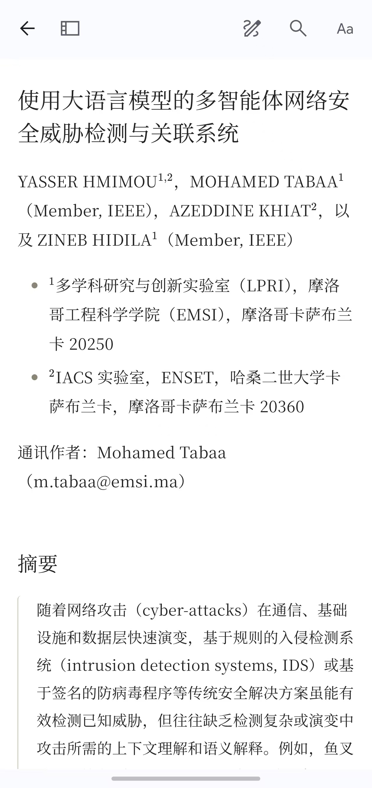

# EasyRead Sync

Sync fully translated EasyRead papers as Zotero attachments named by the translated title, and read them offline on your phone.



An independent plugin based on [zotero-easyread](https://github.com/apple5089/zotero-easyread); it does not modify the original extension or the EasyRead installer.

## Features

- Right-click **同步翻译内容** to sync up to 20 papers at once; only fully translated papers are exported, never re-translated.
- Attachments are script-free static HTML: translation, KaTeX formulas, tables, figures, references; no chat or annotation data.
- Updates reuse the same attachment — no duplicates; unchanged bytes are skipped, missing files restored. Existing `EasyRead翻译` attachments are renamed automatically on the next sync.
- Synced papers are tagged `EasyRead翻译` for library filtering.
- Mobile single-column layout, collapsible TOC, scrollable tables and formulas, dark mode.
- Delivery uses Zotero's existing WebDAV / Zotero Storage; the official [Nutstore plugin](https://github.com/nutstore/zotero-plugin-nutstore) is recommended on mobile.

The upstream open/import and note-sync operations are retained; translation sync never sends or translates PDFs.

## Install

Requires Zotero 10.0.x and a running EasyRead service (export baseline: 1.4.3 / API v1). The PDF must be downloaded in Zotero.

1. Download the XPI from [Releases](https://github.com/Ttungx/easyread-zotero-sync/releases) or build with `python build.py`.
2. Install it in Zotero's Add-ons manager; upgrading from older versions needs no cleanup — existing attachments are renamed on the next sync.
3. Finish the full-text translation in EasyRead.
4. Run the translation-sync command in Zotero; matching is by PDF fingerprint.
5. After desktop sync finishes, download the attachment on Android.

This is a candidate build: isolated-host and live-paper rendering checks passed; real-library use and physical Android remain acceptance gates. See [VALIDATION.md](VALIDATION.md).

## Connection settings

The plugin reuses the original plugin's configured directory and executable path read-only. If discovery fails, open Tools → EasyRead Sync: Connection Settings and set the data directory containing `.server.json`, or an explicit `http://127.0.0.1:port` service URL. Settings save as they change.

## Update protection

**Updating text may invalidate existing Zotero highlight positions on the HTML attachment.** Annotations are never deleted or repositioned automatically.

- Annotated or manually edited attachments are never overwritten silently: batch skips, single-item asks.
- One previous HTML copy is kept under `easyread-zotero-sync-backups/` before each overwrite.
- No overwrite during sync conflicts, pending downloads or an active Zotero sync.

The plugin has its own ID, preferences, protocol and `easyread-zotero-sync.json` registry; the original extension's data is untouched. Uninstalling does not delete imported attachments. The update feed is `updates.json` at the repository root.

## Development

From the project root (Node.js 22+, Python 3.10+, no npm/pip runtime dependencies):

```bash
node --test tests/core.test.cjs tests/compat.test.cjs
python -m unittest discover -s tests -p "test_*.py" -v
python build.py
```

KaTeX and Markdown resources are bundled from the upstream EasyRead sources (MIT licensed).

## License

MIT, see [LICENSE](LICENSE). Bundled KaTeX and Markdown rendering resources are MIT-licensed upstream code. Not affiliated with Zotero or EasyRead.
